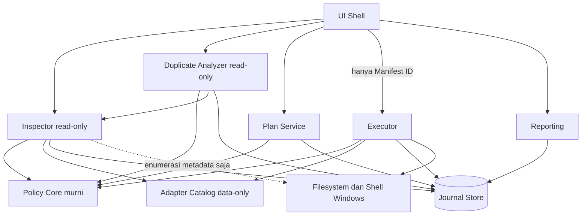
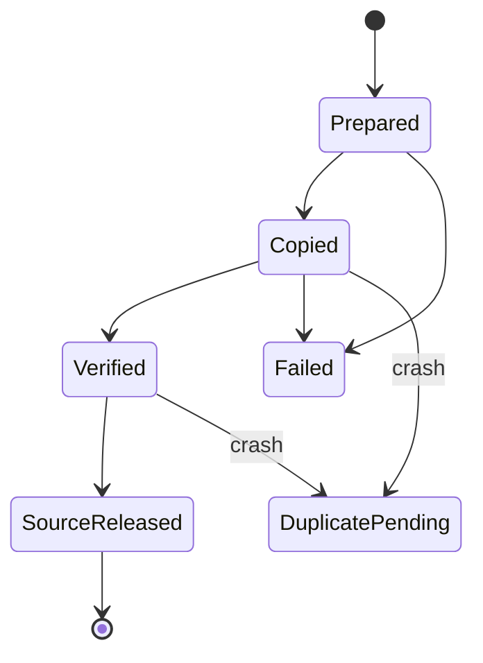
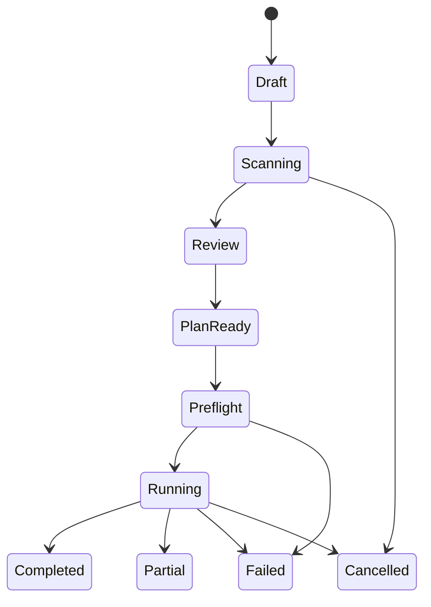

# Design Document: mustbecleaner-storage-cleaner

## Overview

MustBeCleaner adalah aplikasi desktop Windows lokal dan offline yang berfungsi sebagai storage inspector dan app-aware cleaner berbasis kebijakan. Desain ini menerjemahkan Requirement 1 sampai 26 menjadi komponen, antarmuka, model data, properti kebenaran, dan strategi pengujian.

Prinsip desain:

- Deny mengalahkan allow. Protection rule tidak dapat dikalahkan oleh adapter, skor, custom include, atau mode administrator (R5.4, R6.6).
- Tri_State (true/false/unknown). Unknown menolak tindakan (R5.2, R5.3).
- Deteksi, penentuan tidak-terpakai, dan izin penghapusan adalah tiga keputusan terpisah (R5.7).
- Sisi baca (Inspector) dan sisi mutasi (Executor) dipisahkan secara struktural (R1.3, R10.5, R11.6).
- Seleksi awal kosong, registry off dan review-only, tidak ada pembersihan otomatis (R10.1, R17).
- Semua fitur berjalan offline tanpa telemetry (R23).

### Keputusan Stack (Terbuka)

Desain ini technology-agnostic. Stack final adalah keputusan terbuka (Requirements, keputusan terbuka 1). Opsi yang direkomendasikan oleh `docs/PRODUCT_BLUEPRINT.md` bagian 10 adalah **C# + WPF + .NET yang masih didukung + SQLite**, dengan alasan interop Windows langsung, satu ekosistem untuk engine dan UI, serta virtualisasi tabel yang matang. Alternatif: WinUI 3 dan Tauri. Rekomendasi ini bukan keputusan pengguna. Nama teknologi di dokumen ini hanya muncul sebagai ilustrasi dan tidak mengikat.

### Ringkasan Riset

Temuan yang memengaruhi desain (dari blueprint dan riset kompetitor, bukan pengujian pada perangkat ini):

- Pemindahan lintas volume tidak atomik. Maka diperlukan Journal per Item dengan tahap Prepared, Copied, Verified, SourceReleased (R12.2).
- Hard link, junction, dan reparse point mengubah semantik path. Identitas Item memakai volume ID dan file ID, bukan string path ([Hard links and junctions](https://learn.microsoft.com/en-us/windows/win32/fileio/hard-links-and-junctions), [Reparse points](https://learn.microsoft.com/en-us/windows/win32/fileio/reparse-points)).
- SQLite WAL adalah bagian state persisten database, sehingga database, WAL, SHM, dan journal diperlakukan sebagai satu Transaction_Set ([SQLite WAL](https://www.sqlite.org/wal.html)).
- Recycle Bin pada volume yang sama tidak membebaskan ruang, dan outcome per Item harus dibaca tanpa fallback ke penghapusan permanen ([IFileOperation flags](https://learn.microsoft.com/en-us/windows/win32/api/shobjidl_core/nf-shobjidl_core-ifileoperation-setoperationflags)).
- Electron memisahkan lokasi executable dari userData dan sessionData, sehingga seluruh AppData tidak boleh dianggap disposable ([Electron app API](https://www.electronjs.org/docs/latest/api/app)).
- Canonical string path saja tidak menyelesaikan TOCTOU. Pengikatan identitas objek antara preview dan aksi memerlukan spike Win32 dan menjadi gerbang rilis (R21.4).

Konten sumber di atas diringkas ulang untuk kepatuhan lisensi.

## Architecture

Arsitektur yang dipilih adalah **Split-Privilege Pipeline**: Inspector bersifat read-only, Executor satu-satunya pemutasi filesystem, Policy Core murni tanpa I/O dipakai bersama, dan Journal Store sebagai batas persistence. Rincian alternatif (Layered, Event-sourced) dan metrik estimasi ada di `architecture_selection.md`. Metrik tersebut adalah estimasi kualitatif, bukan hasil pengukuran kode.

### Alasan Pemilihan

Kebutuhan terkuat adalah invarian keselamatan: Scanner tidak punya API mutasi (R1.3), UI hanya mengirim Manifest ID (R10.5), dan Executor memeriksa ulang proteksi sendiri (R11.6). Pemisahan pada batas komponen membuat invarian itu struktural. Policy Core yang murni membuat evaluasi ulang deterministik dan mudah diuji, termasuk dengan PBT. Trade-off: lebih banyak komponen dan satu batas persistence (Plan, Manifest, Journal) yang harus dijaga konsisten. Layered lebih cepat dibangun, tetapi proteksi bergantung pada disiplin kode.

### Diagram Komponen



### Komponen dan Kepemilikan State

| Komponen | State yang dimiliki | Tanggung jawab |
|----------|---------------------|----------------|
| Policy Core | Rule set berversi, daftar proteksi, definisi Tri_State | Klasifikasi Protected/Review/Eligible, eligibility, normalisasi path, rule ID dan alasan. Murni, tanpa I/O |
| Adapter Catalog | Adapter data-only, provenance, diff impor | Pemetaan aplikasi dan versi ke lokasi, kategori, blocker, proses pemilik |
| Inspector | ScanRun, ScanCoverage, DiscoveredItem | Enumerasi metadata read-only, coverage, overview, delta antar-scan, identitas Item |
| Duplicate Analyzer | DuplicateGroup, hash cache | Exact file/folder (size, SHA-256, byte verify, Folder_Manifest) dan fuzzy review-only |
| Plan Service | CleanupPlan, PlanItem, KeeperDecision, Manifest | Seleksi awal kosong, total non-overlap, Manifest immutable |
| Executor | ActionAttempt, QuarantineEntry, RestoreAttempt | Preflight, revalidasi, quarantine C: ke D:, Recycle, restore, state machine eksekusi |
| Journal Store | Journal, ExceptionEntry, RuleVersion, entitas persisten | Persistence durable di Data_Directory, retention, recovery crash saat startup |
| Reporting | Laporan dan export | Akuntansi byte terpisah, outcome per Item, redaksi path |
| UI Shell | View state, tema, preferensi | Workspace inspeksi, filter, inspector, aksesibilitas |

### Alur Informasi

Tidak ada siklus sinkron. UI memanggil ke bawah. Komponen lain hanya memanggil Policy Core, Adapter Catalog, dan Journal Store. Progress dikirim ke UI lewat event, bukan callback sinkron. UI ke Executor hanya membawa Manifest ID.

### Invarian Hasil Desain

1. Hanya Executor yang memegang kemampuan mutasi filesystem.
2. Executor menghitung ulang klasifikasi lewat Policy Core dan tidak mempercayai status dari Inspector atau UI.
3. Manifest immutable setelah dibuat.
4. Journal ditulis durable sebelum setiap mutasi, dan Store menolak mutasi tanpa entri Journal.
5. Policy Core tidak melakukan I/O. Fakta dunia nyata (proses aktif, identitas) disuplai sebagai input, sehingga unknown dapat dinyatakan eksplisit.
6. Data_Directory dan Quarantine dikecualikan dari scan. Jika lokasi hilang, Store gagal tertutup tanpa fallback ke C:.

### Alokasi Requirement

| Requirement | Komponen |
|-------------|----------|
| R1 Scope, read-only | Inspector, Policy Core |
| R2-R3 Scan, coverage | Inspector, Journal Store |
| R4 Overview, delta | Inspector |
| R5-R7 Klasifikasi, proteksi, link/identitas | Policy Core |
| R8 Adapter | Adapter Catalog |
| R9 Preview | UI Shell |
| R10 Seleksi, Plan | Plan Service |
| R11 Eligibility, preflight | Executor |
| R12-R13 Quarantine, eksekusi | Executor |
| R14 Laporan | Reporting |
| R15 Restore | Executor |
| R16 Audit | Journal Store |
| R17 Registry review | Inspector (read-only) |
| R18-R20 Duplicate dan fuzzy | Duplicate Analyzer |
| R21-R23 Pengujian, performa, privasi | Lintas komponen |
| R24-R26 UI, tema, aksesibilitas | UI Shell |

### Struktur Implementasi (Ilustrasi bila C#/WPF dipilih)

```text
src/Desktop/          views, viewmodels, tema
src/Application/      jobs, plans, reporting
src/Domain/           identitas Item, policy, outcome (Policy Core)
src/Infrastructure/   enumerasi, Win32, SQLite, journal
src/Adapters/         deteksi aplikasi/versi
src/Duplicates/       hashing, manifest, similarity
policies/             data deklaratif, skema, provenance
tests/                unit, properti, fixture, adversarial, crash
```

## Components and Interfaces

Antarmuka dinyatakan secara netral terhadap bahasa. Tipe memakai notasi pseudo.

### Policy Core (murni)

```text
classify(item: ItemFacts, facts: WorldFacts, ruleSet: RuleSet) -> Classification
normalizePath(raw: string) -> CanonicalPath | Rejected(reason)
isExcluded(path, exclusions) -> bool
```

- `ItemFacts`: identitas Item, ancestor, volume, atribut, kepemilikan dari Adapter.
- `WorldFacts`: hasil pengamatan (proses aktif, lock, fingerprint aplikasi) dengan nilai Tri_State. Jika tidak teramati, nilainya unknown.
- `Classification`: `{ status: Protected|Review|Eligible|InventoryOnly, ruleId, ruleVersion, reasons[], conditions: Map<Condition, TriState> }`.
- Urutan evaluasi: exclusion, penolakan path (UNC, device, ADS), protection rule, kecocokan Adapter, kondisi eligibility. Protection mengalahkan semuanya. Eligible hanya jika seluruh kondisi R11.1 bernilai true.

### Adapter Catalog

```text
loadAdapters() -> Adapter[]
matchAdapter(item, appFingerprint) -> AdapterMatch | NoMatch | VersionMismatch
importUpdate(package) -> ImportDiff   // verifikasi provenance, tampilkan diff, tanpa perluasan scope diam-diam
```

Adapter berisi: rule ID, versi, sumber referensi, fingerprint, relative path yang diizinkan, kategori, blocker, mapping proses dan helper, bukti yang diperlukan, biaya regenerasi, kebijakan recovery (R8.1). Tidak ada eksekusi skrip dari Adapter (R8.2). Status awal adapter yang tercantum di R8.3 adalah inventory-only.

### Inspector

```text
scan(scope: Scope, options) -> ScanRun   // event: progress, coverage
cancel(scanId) / pause(scanId)
overview(scanId) -> StorageOverview
delta(scanA, scanB) -> Delta
```

Inspector hanya mengenumerasi metadata. Reparse point tidak ditelusuri (R7.1, R7.2). Hard link dihitung sekali berdasarkan (volume ID, file ID) (R4.6).

### Duplicate Analyzer

```text
findExactFiles(scope) -> DuplicateGroup[]       // size -> SHA-256 penuh -> verifikasi byte
buildFolderManifest(folder) -> FolderManifest | Unsupported(reason)
findExactFolders(scope) -> DuplicateGroup[]
findFuzzy(scope, type) -> FuzzyCandidate[]      // review-only
```

`FolderManifest` adalah daftar terurut `(relativePath, entryType, size, contentHash)`. Pengurutan memakai kunci kanonik (path ternormalisasi), sehingga hasil tidak bergantung pada urutan enumerasi (R19.8).

### Plan Service

```text
select(items) -> Plan                 // total non-overlap
selectEligible(items) -> Selection    // hanya Eligible (R9.5)
approve(plan) -> Manifest | Rejected  // tolak jika ada non-Eligible (R10.7), grup tanpa Keeper (R18.4)
```

### Executor

```text
run(manifestId: ManifestId) -> ExecutionRun   // tidak menerima path arbitrer (R10.5)
cancel(runId)
restore(quarantineEntryId) -> RestoreAttempt
purge(quarantineEntryId)                        // aksi eksplisit terpisah (R12.8)
recoverOnStartup() -> RecoveryReport
```

Alur per Item: preflight (R11.2) lalu revalidasi lewat Policy Core, tulis Journal Prepared, salin ke Quarantine (Copied), verifikasi checksum dan metadata (Verified), lepas sumber (SourceReleased). Perubahan sumber saat salin membatalkan pelepasan (R12.4).



State machine eksekusi (R13.1):



### Reporting

```text
buildReport(runId) -> Report
export(report, format: CSV|JSON|HTML, redactPaths: bool)
```

Angka byte dipisah: `logicalSelected`, `estimatedAllocatedReclaimable`, `processedLogical`, `observedFreeSpaceDelta`, `quarantineDestinationBytes` (R14.1).

### UI Shell

Navigasi sesuai R24.2. Tabel kandidat sebagai focal point, inspector kanan, ringkasan pilihan di bawah. UI tidak memegang referensi ke API mutasi. Tema light/dark/system dengan palet pastel sage (R25). Token warna mengikuti usulan blueprint bagian 13.

## Data Models

Entitas persisten (R16.4), disimpan di Data_Directory lokal dengan ACL pengguna.

```text
ItemIdentity   { volumeId, fileId, canonicalPath, size, mtime, attributes }
ScanRun        { scanId, scope[], startedAt, status, policyVersion, caveats[] }
ScanCoverage   { scanId, root, status, entryCount, reparseSkipped, accessDenied, durationMs }
DiscoveredItem { itemId, scanId, identity: ItemIdentity, sizeOrUnavailable }
AppOwnershipEvidence { itemId, adapterRuleId, adapterVersion, evidence[] }
RuleVersion    { ruleId, version, sourceRef, hash }
Classification { itemId, status, ruleId, ruleVersion, reasons[], conditions }
DuplicateGroup { groupId, kind: File|Folder, members[], keeperId?, verified }
KeeperDecision { groupId, keeperItemId }
CleanupPlan    { planId, items[], totals }
PlanItem       { planId, itemId, evidenceSnapshot }
Manifest       { manifestId, hash, planId, policyVersion, items[] }   // immutable
ActionAttempt  { itemId, manifestId, journalStage, outcome, reason }
QuarantineEntry{ entryId, itemId, location, checksum, metadata }
RestoreAttempt { entryId, status, reason }
ExceptionEntry { itemId, reasonCode, timestamp }
```

Nilai enum penting:

- `Status`: Protected, Review, Eligible, InventoryOnly.
- `TriState`: True, False, Unknown.
- `Outcome`: quarantined, recycled, skipped-active, skipped-changed, denied-policy, failed, canceled, recovery-required (R14.5).
- `JournalStage`: Prepared, Copied, Verified, SourceReleased.

Catatan model:

- `Manifest.hash` dihitung dari serialisasi kanonik daftar item dan evidence. Manifest tidak punya operasi update.
- `sizeOrUnavailable` menyatakan `unavailable` secara eksplisit, tidak pernah nol (R3.5).
- Log tidak menyimpan isi file, token, atau secret (R16.3).

## Correctness Properties

*A property is a characteristic or behavior that should hold true across all valid executions of a system-essentially, a formal statement about what the system should do. Properties serve as the bridge between human-readable specifications and machine-verifiable correctness guarantees.*

Hasil refleksi redundansi: kriteria R5.4, R6.6, dan R11.1 digabung menjadi Property 1 dan 2; R3.7, R4.6, R10.2, R14.4, R18.7 digabung menjadi Property 5; R19.1-19.3 dan R19.8 dipisah menjadi Property 9 (invarian urutan) dan 10 (diskriminasi isi); R12.2 dan R12.3 digabung menjadi Property 13.

### Property 1: Proteksi mengalahkan allow

*For any* Item yang cocok dengan sedikitnya satu protection rule, dan *for any* kombinasi Adapter, skor, custom include, dan mode administrator, klasifikasi hasil SHALL Protected dan Item tidak dapat masuk Plan.

**Validates: Requirements 5.4, 6.6**

### Property 2: Unknown memblokir, Eligible hanya jika semua true

*For any* vektor kondisi eligibility Tri_State, Item berstatus Eligible jika dan hanya jika setiap kondisi bernilai true dan tidak ada protection rule yang cocok. Jika sedikitnya satu kondisi unknown atau false, status bukan Eligible dan tindakan ditolak. Setiap Item mendapat tepat satu status.

**Validates: Requirements 5.1, 5.2, 5.3, 11.1**

### Property 3: Klasifikasi deterministik

*For any* masukan (ItemFacts, WorldFacts, RuleSet), dua evaluasi berurutan SHALL menghasilkan Classification identik, termasuk rule ID, versi, dan alasan.

**Validates: Requirements 5.5, 5.6**

### Property 4: Exclusion mengalahkan include; path terlarang ditolak; normalisasi idempoten

*For any* path dan himpunan include/exclusion, jika exclusion cocok maka Item dikecualikan. *For any* path UNC, device path, atau alternate data stream, Item ditolak. *For any* path, `normalizePath(normalizePath(p)) == normalizePath(p)`, dan variasi case, nama 8.3, serta prefix path panjang yang setara menghasilkan bentuk kanonik yang sama.

**Validates: Requirements 1.7, 7.4, 7.5**

### Property 5: Total byte tanpa overlap

*For any* himpunan Item yang mungkin memuat hubungan parent-child, hard link (volume ID dan file ID sama), dan file yang muncul dari dua Scope, total Logical_Bytes pada Plan dan laporan SHALL sama dengan jumlah ukuran himpunan Item unik non-overlap, tidak bergantung pada urutan masukan, dan tidak menyertakan Item yang dibatalkan.

**Validates: Requirements 3.7, 4.6, 10.2, 14.4, 18.7**

### Property 6: Seleksi hanya mengambil Eligible dan dimulai kosong

*For any* daftar Item dengan status campuran, seleksi awal SHALL kosong, "Pilih kandidat yang memenuhi policy" menghasilkan subset dari Item Eligible saja, dan menerapkan filter aplikasi tidak mengubah seleksi.

**Validates: Requirements 9.5, 9.6, 10.1**

### Property 7: Plan dengan Item non-Eligible atau fuzzy ditolak

*For any* Plan yang memuat sedikitnya satu Item bukan Eligible atau satu Fuzzy_Candidate, pembuatan Manifest SHALL ditolak. Fuzzy_Candidate tidak pernah dipromosikan menjadi Exact_Duplicate oleh threshold apa pun.

**Validates: Requirements 10.7, 20.2, 20.8**

### Property 8: Keeper dipertahankan per grup

*For any* DuplicateGroup dan pilihan Item untuk tindakan, Plan yang valid SHALL menyisakan sedikitnya satu anggota terverifikasi per grup sebagai Keeper. Plan yang akan menghapus seluruh anggota grup ditolak. Jika Keeper hilang atau berubah saat preflight, tindakan grup tersebut dibatalkan.

**Validates: Requirements 18.4, 18.6, 19.7**

### Property 9: Folder_Manifest tak bergantung urutan enumerasi

*For any* pohon folder dan *for any* permutasi urutan enumerasi entry, Folder_Manifest yang dibangun SHALL identik, dan nama root folder tidak memengaruhi manifest.

**Validates: Requirements 19.2, 19.8**

### Property 10: Exact duplicate ditentukan oleh isi

*For any* dua folder yang enumerasinya lengkap, keduanya Exact_Duplicate jika dan hanya jika Folder_Manifest identik (struktur relatif, folder kosong, tipe entry, hash isi). Mengubah satu byte pada satu file, menambah atau menghapus satu entry (termasuk folder kosong) SHALL mengubah manifest. *For any* kumpulan file, anggota satu grup Exact_Duplicate identik byte per byte, dan dua file identik berada pada grup yang sama. File dengan nama atau ukuran sama tetapi isi berbeda tidak pernah berada pada grup yang sama.

**Validates: Requirements 18.2, 18.3, 19.1, 19.3**

### Property 11: Folder dengan fitur tidak didukung atau overlap ditolak

*For any* pasangan folder yang memuat symlink, ADS, EFS, sparse/cloud file, topologi hard link, ambiguitas case-sensitive, atau entry tidak terbaca, pasangan SHALL ditandai unsupported-for-cleanup. *For any* pasangan path dengan hubungan ancestor-descendant, pasangan ditolak.

**Validates: Requirements 19.4, 19.5**

### Property 12: Cache hash diinvalidasi saat identitas berubah

*For any* entri cache hash dan perubahan identitas atau metadata Item (ukuran, mtime, file ID, atribut), pencarian cache SHALL miss. Cache hit hanya jika seluruh identitas sama.

**Validates: Requirements 18.10**

### Property 13: Urutan Journal dan kehilangan data nol

*For any* urutan event Journal yang diterapkan pada filesystem fake, hanya transisi maju Prepared, Copied, Verified, SourceReleased yang diterima. Sumber SHALL tidak dilepas kecuali checksum, ukuran, dan metadata yang didukung terverifikasi cocok. *For any* titik crash yang disuntikkan pada setiap tahap, sedikitnya satu salinan utuh Item ada setelah recovery, dan status yang dilaporkan sesuai tahap terakhir (termasuk duplicate-pending).

**Validates: Requirements 12.2, 12.3, 12.6, 21.3**

### Property 14: Restore tidak menimpa dan mempertahankan Quarantine saat gagal

*For any* target restore yang sudah berisi data, restore SHALL dihentikan tanpa mengubah data target. *For any* kegagalan restore, Item tetap berada di Quarantine.

**Validates: Requirements 15.3, 15.4**

### Property 15: Preflight melewati Item yang berubah atau aktif

*For any* fakta preflight (pemilik aktif atau tidak teramati, identitas atau ancestor berubah, versi policy berbeda), outcome SHALL skipped-active, skipped-changed, atau penolakan seluruh eksekusi sesuai kondisi, dan tidak pernah ada mutasi pada Item yang dilewati.

**Validates: Requirements 11.3, 11.4, 11.5, 11.6**

### Property 16: Akuntansi outcome dan byte konsisten

*For any* hasil eksekusi, jumlah Item per outcome SHALL sama dengan jumlah Item di Manifest, status Partial ditetapkan jika ada campuran outcome sukses dan gagal, dan Item di Recycle Bin pada volume yang sama tidak dihitung ke Reclaimed_Bytes. Ukuran yang tidak terukur SHALL dilaporkan unavailable, bukan nol.

**Validates: Requirements 3.5, 13.6, 14.1, 14.3, 14.5**

### Property 17: State machine hanya menerima transisi sah

*For any* urutan event, state machine eksekusi SHALL hanya berpindah melalui transisi yang didefinisikan pada diagram, dan setiap transisi mencatat timestamp, scan ID, plan ID, dan kode alasan.

**Validates: Requirements 13.1, 13.2**

### Property 18: Adapter tidak cocok menjadi Review

*For any* Item milik Adapter dan fingerprint atau versi aplikasi yang tidak cocok, status SHALL Review (bukan Eligible). Folder yang tidak dikenali Adapter apa pun SHALL berstatus InventoryOnly dan tidak ikut pemilihan massal.

**Validates: Requirements 5.8, 8.13**

### Property 19: Round trip serialisasi Manifest dan laporan

*For any* Manifest atau Report valid, serialisasi lalu deserialisasi menghasilkan objek ekuivalen, hash Manifest stabil, dan perubahan isi apa pun mengubah hash. Export dengan redaksi path tidak memuat path asli.

**Validates: Requirements 9.8, 10.4**

### Property 20: Log tidak memuat secret

*For any* entri log atau Exception_Log yang dibuat dari Item yang isinya berisi token atau secret, keluaran log tidak memuat isi tersebut.

**Validates: Requirements 16.3**

### Property 21: Metrik nama simetris

*For any* dua nama atau path, jarak setelah normalisasi token bernilai simetris, nol untuk nama yang identik setelah normalisasi, dan tidak pernah menghasilkan status Exact_Duplicate.

**Validates: Requirements 20.3**

## Error Handling

| Kondisi | Perilaku | Requirement |
|---------|----------|-------------|
| Access denied | Catat di Exception_Log, tidak ada eskalasi | R6.8 |
| Scan dibatalkan atau error | Hasil berlabel tidak lengkap, ukuran sebagai batas bawah | R2.3, R3.2 |
| Ruang bebas < 100 MiB | Tulis hanya ke Data_Directory yang dapat ditulis, tolak scan bila tidak bisa | R2.6 |
| Ukuran tidak terukur | Tampilkan unavailable | R3.5 |
| Condition unknown | Tolak tindakan, tampilkan Belum dapat dinilai dengan alasan | R5.3, R24.5 |
| Sumber berubah saat salin | Batalkan pelepasan sumber, outcome failed | R12.4 |
| Metadata tidak didukung | Tolak tindakan atas Item | R12.5 |
| Crash dengan dua salinan | duplicate-pending saat startup, tanpa menebak | R12.6 |
| Data_Directory atau Quarantine hilang/penuh | Berhenti, tanpa fallback ke C: | R12.9 |
| Versi policy berubah | Tolak eksekusi, minta Plan baru | R11.5 |
| Recycle gagal | Tidak fallback ke penghapusan permanen | R12.7 |
| Gagal menulis laporan | Peringatan audit evidence tidak lengkap | R14.6 |
| Restore bentrok | Hentikan tanpa menimpa | R15.3 |
| Keeper hilang atau berubah | Batalkan tindakan grup | R18.6 |
| File tidak terbaca saat hashing | Keluarkan dari grup, catat di Exception_Log | R18.11 |
| Volume bukan NTFS lokal | InventoryOnly | R7.7 |

Prinsip umum: gagal tertutup. Setiap penolakan membawa kode alasan yang tercatat di Exception_Log.

## Testing Strategy

### Pendekatan Ganda

- **Unit test dan example test**: contoh konkret, titik integrasi, dan kasus tepi (adapter awal R8, state UI R24.8, laporan sebagian).
- **Property-based test**: properti universal pada Policy Core, akuntansi byte, Folder_Manifest, Plan Service, state machine, dan Journal dengan filesystem fake.
- **Integration dan adversarial test (bukan PBT)**: dijalankan di fixture, sandbox, atau VM, tidak pernah pada data riil pengguna (R21.2). Mencakup daftar R21.1 (junction swap setelah preview, WAL aktif, D: penuh atau hilang, crash per tahap Journal, konflik restore, dan seterusnya).
- **Smoke test**: Scanner tanpa dependensi API mutasi, tidak ada registry writer, nol lalu lintas keluar (R1.3, R17.3, R23.4).
- **Tes UI**: snapshot, navigasi keyboard, audit kontras 4,5:1 dan 3:1, dan tinjauan dengan teknologi bantu. Klaim WCAG penuh tidak dibuat tanpa validasi pakar (R26.7).

PBT tidak diterapkan pada rendering UI, tata letak, konfigurasi distribusi, atau lapisan I/O Windows sungguhan. Pada lapisan I/O, PBT hanya dipakai terhadap filesystem fake yang meniru kegagalan.

### Konfigurasi Property-Based Test

- Pustaka PBT dipilih sesuai stack final dan tidak diimplementasikan dari nol. Jika C# dipilih, FsCheck atau CsCheck adalah kandidat. Pilihan ini mengikuti keputusan stack yang masih terbuka.
- Minimum 100 iterasi per properti.
- Setiap properti diimplementasikan oleh satu property-based test.
- Setiap test diberi tag: **Feature: mustbecleaner-storage-cleaner, Property {nomor}: {teks properti}**.
- Generator: pohon folder acak (nama dengan case, 8.3, Unicode, folder kosong), hard link, Tri_State vector, daftar status campuran, urutan event Journal dengan titik crash.

### Gerbang Rilis

- Nol false positive kritikal pada korpus pengujian sebelum Fase 2 lulus (R21.5).
- Fitur destruktif ditahan sampai terbukti objek yang direview identik dengan objek yang dipindah (R21.4).
- Gerbang performa ditetapkan setelah baseline di hardware target (R22.1). Tidak ada klaim ukuran binary, RAM, atau kecepatan sebelum pengukuran (R22.4).

### Keputusan Terbuka yang Memengaruhi Pengujian

Stack final, distribusi (portable atau installer), versi Windows minimum, adapter pertama yang terbukti disposable, kontrak folder exact untuk metadata yang didukung, dan parser fuzzy awal. Desain ini tidak menetapkannya.
