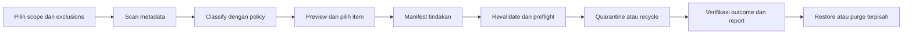
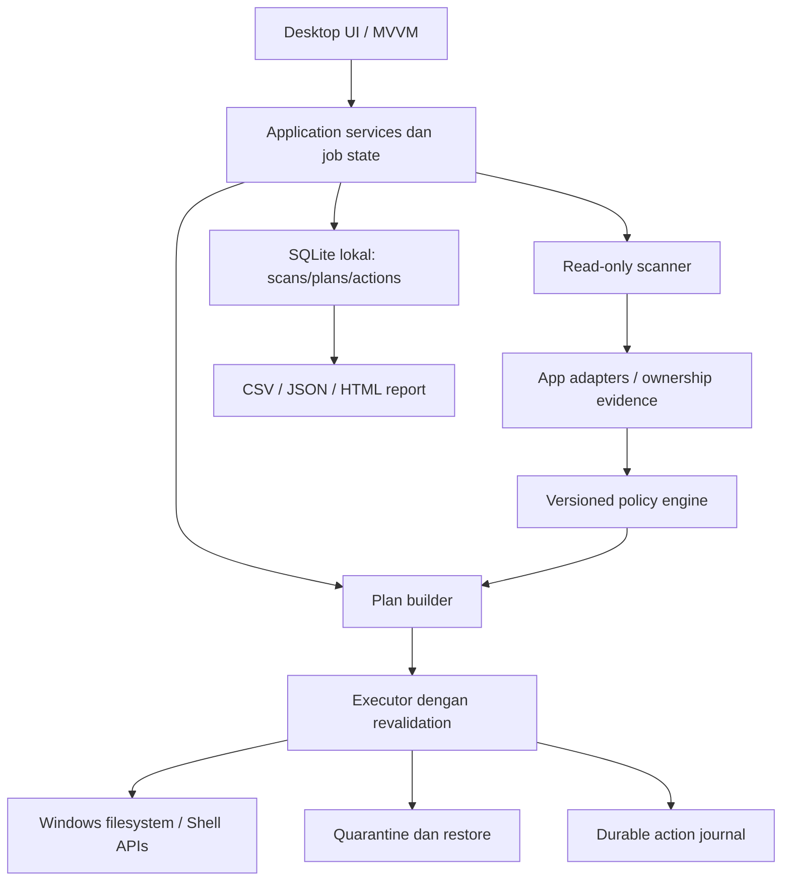

# Cleaner Windows perlu memahami kepemilikan data sebelum menghapusnya

Status: **blueprint usulan**, 9 November 2026. Belum ada cleanup engine, UI executable, perubahan registry, deployment, atau acceptance test produk. Windows lokal/offline dan tahap blueprint dikonfirmasi pengguna. Stack, nama, threshold, dan prioritas implementasi di bawah merupakan rekomendasi engineering yang belum menjadi keputusan pengguna.

## 1. Kesimpulan produk

Bangun **storage inspector dan policy-driven cleaner**. Pengguna harus dapat melihat mengapa suatu item ditemukan, siapa pemiliknya, apakah dapat dibuat ulang, apa dampaknya jika dipindahkan, dan bagaimana memulihkannya. Jangan memasarkan sebagai alat yang menjamin semua junk dapat dikenali atau seluruh slowdown dapat diperbaiki.

Masalah awal memiliki dua lapisan: kapasitas C: yang rendah dan pertumbuhan data aplikasi di profil pengguna. Pemasangan executable di D: tidak berarti profile/cache ikut berpindah. Electron, misalnya, memisahkan lokasi executable dari `userData` dan `sessionData`; storage session dapat berisi cookies dan localStorage selain cache. Karena itu seluruh AppData tidak boleh diklasifikasikan disposable. [Electron app API](https://www.electronjs.org/docs/latest/api/app).

Product promise usulan: **lihat footprint, pahami risikonya, pilih tindakan, verifikasi hasilnya**. Tidak ada iklan, account requirement, analytics, cloud upload, atau paywall cleanup. Tidak ada janji performance uplift sebelum benchmark.

## 2. Brainstorming: tiga pendekatan dan keputusan yang disarankan

| Pendekatan | Kelebihan | Kelemahan | Judgment |
|---|---|---|---|
| Generic aggressive cleaner | Banyak temuan, cepat dibuat dengan wildcard | False positive; sulit membuktikan unused; kerusakan lintas aplikasi | Jangan dipakai sebagai dasar |
| Storage inspector saja | Risiko mutasi rendah; diagnosis jelas | Pengguna masih harus menindaklanjuti manual | Fondasi fase pertama |
| App-aware cleaner dengan explicit policy | Bisa menunjukkan ownership, regenerate cost, recovery | Memerlukan adapter dan validasi per versi aplikasi | Target produk |

Insight utama: **identifikasi cache**, **identifikasi tidak terpakai**, dan **izin menghapus** adalah tiga keputusan berbeda. Tidak ada proses terdeteksi bukan bukti sebuah runtime orphan. Tanggal modifikasi lama bukan bukti last use. Exact duplicate konten juga bukan bukti kedua lokasinya interchangeable.

Jangan pakai LLM untuk memberikan izin penghapusan. Deteksi dan policy harus deterministik, offline, versioned, dapat diuji. Fuzzy matching hanya membantu review.

## 3. Pelajaran dari produk pembanding

Riset rinci dan batas evidence tersedia di [competitor-research.md](research/competitor-research.md). Observasi berasal dari dokumentasi/screenshot vendor, bukan menjalankan aplikasi vendor pada device ini.

- Adaptasikan pemisahan analisis, preview, dan tindakan dari pola cleaner yang sudah dikenal.
- Bedakan CCleaner current v7 dari workflow legacy Analyze/Run Cleaner; nama tombol dan urutan tidak boleh dicampur menjadi satu versi rekaan.
- AI cache cleaning bukan diferensiasi unik. Diferensiasi usulan adalah evidence, protection, recoverability, dan kebijakan lokal yang transparan.
- Jangan meniru driver updater, antivirus, startup optimizer, software updater, disk wipe, atau performance booster. Itu di luar scope cache/storage/junk/duplicates.
- Jangan mewarisi kategori vendor yang mencampur history, local models, dan cache. Untuk produk ini history/model/data lokal diproteksi terpisah.

## 4. Scope fitur dan default tindakan

| Modul | Scope | Default |
|---|---|---|
| Storage overview | Drive, folder, app, kategori, perubahan antar-scan | Read-only |
| App cache cleaner | Adapter aplikasi/versi yang dikenali | Scan; checkbox file awal kosong |
| Temporary data | Temp yang dimiliki rule dan memenuhi eligibility | Review; tidak hapus root Temp |
| AI & developer storage | Codex/Claude/Qoder/OpenCode/Code/Go dan adapter berikutnya | Inventory; unknown dilindungi |
| Exact duplicates | File konten identik dan folder manifest identik | Semua unchecked; pilih keeper |
| Similar items | Nama, teks, gambar, struktur folder | Review-only; tidak ada bulk delete |
| Large files / growth | Ranking ukuran dan delta scan | Bukan otomatis junk |
| Registry review | Temuan narrowly scoped di kemudian hari | Off/unchecked; MVP tanpa writer |
| Recovery & reports | Manifest, outcome, restore, export lokal | Tersedia sesuai action method |

User request registry tetap dicatat. Rekomendasi membatasi MVP pada review tanpa modifikasi **bukan keputusan untuk menghilangkan fitur**. Registry writer hanya layak menjadi fase terpisah setelah use case, rules, backup/restore, dan kriteria keselamatan disepakati. Ukuran registry tidak dipromosikan sebagai sumber penghematan storage yang berarti tanpa pengukuran.

## 5. Safety policy: deny harus mengalahkan allow

Decision rule usulan:

```text
eligible = supported_local_scope
       AND trusted_adapter_matches_app_and_version
       AND confirmed_disposable_category
       AND no_protection_rule_matches
       AND owner_is_quiescent_and_no_unknown_activity
       AND identity_and_metadata_unchanged_since_preview
       AND recovery_method_ready
       AND user_selected_this_manifest_item
```

Semua kondisi bernilai tiga: true / false / unknown. **Unknown menolak tindakan**. Score confidence tidak dapat melewati protection rule. Custom include maupun admin mode tidak dapat menonaktifkan critical protections.

| Guardrail | Enforcement di backend | Alasan |
|---|---|---|
| Windows critical roots | Tolak Windows, WinSxS, System32, SysWOW64, boot/EFI, Recovery, System Volume Information, driver store, Windows Installer cache, pagefile/hiberfil/swapfile | Nama junk bukan bukti aman |
| App binaries & runtime | Program Files/WindowsApps dan installation roots tidak menjadi target recursive cleaner; DLL/EXE/SYS/OCX serta binary dependency diproteksi | Runtime lama bisa tetap direferensikan |
| Identitas & user data | Credentials, tokens, keys, settings, chat/session/memory, worktrees/repos, unsaved buffers, backups, local models diproteksi | Kehilangan data/akses |
| Database transaction set | DB, WAL, SHM, journals diproteksi sebagai satu unit | WAL dapat berisi transaksi committed yang belum checkpoint |
| Active / uncertain owner | Skip jika proses pemilik/helper aktif, lock/lease ada, pemeriksaan ditolak, atau status tidak pasti | Proses tidak terlihat bukan bukti tidak digunakan |
| Link & path escape | Jangan traverse junction/symlink/mount/cloud reparse; cek seluruh ancestor, final path dan volume identity; reject UNC/device paths/ADS | Hindari keluar scope dan data cloud |
| Hard link / storage accounting | Deduplicate volume+file ID; jangan menganggap setiap pathname punya allocation terpisah | Mencegah double count dan salah action |
| Permission boundary | Standard user, tanpa take ownership/ubah ACL/stop service otomatis | Access denied menjadi exception |
| Unknown folders | Inventory-only, tidak ikut select-all | False positive dibatasi |

Catatan: ekstensi `.dll` saja tidak cukup untuk melindungi sistem. File krusial bisa tanpa ekstensi; policy harus memakai ownership, root, identity, dan app semantics. Sebaliknya folder bernama `Cache` bisa memuat data unik; nama folder tidak menjadi allow rule tunggal.

Registry critical keys, machine-wide keys, boot, service, driver, COM registration, security policy, dan installed product metadata tidak menjadi target generic scan-and-fix. Restore point bukan jaminan pemulihan file atau registry yang lengkap.

Dasar teknis: Windows mendukung hard link yang menunjuk file yang sama, serta junction antar-volume; reparse points mengubah perilaku path. [Hard links and junctions](https://learn.microsoft.com/en-us/windows/win32/fileio/hard-links-and-junctions), [Reparse points](https://learn.microsoft.com/en-us/windows/win32/fileio/reparse-points). SQLite mendokumentasikan WAL sebagai bagian state persisten database; jangan menghapusnya sebagai junk. [SQLite WAL](https://www.sqlite.org/wal.html).

## 6. Adapter aplikasi: daftar folder bukan izin menghapus

| App/lokasi | Kandidat investigasi | Data yang diproteksi | Bukti sebelum eligibility |
|---|---|---|---|
| `.codex` | Cache/log/temp yang rule-nya tervalidasi | sessions, archived_sessions, memories, auth/config, SQLite+WAL, .chatgpt-projects, worktrees, skills/plugins aktif, .sandbox-bin | Jenis artefak, versi, lifecycle, app idle, regenerate behavior |
| Codex Local/OpenAI/Packages | HTTP/GPU/code cache yang dikonfirmasi | profile storage, cookies, indexed DB, settings, runtime | Deteksi desktop install/package ID dan actual profile path |
| Claude / claude-mem | Hanya cache rule-backed | memory DB, vectors, history, session, credentials, settings | Ownership dan documented lifecycle; nama `mem` tidak berarti temporary |
| AutoClaw 2 | Inventory dahulu | agents, runtimes, settings, credentials, artifacts | Layout/version belum diverifikasi |
| Code/Qoder/OpenCode | HTTP/GPU/code cache per profile | User, Backups, History, globalStorage/workspaceStorage, extensions, databases, unsaved drafts | Adapter per produk; jangan menganggap semua fork identik |
| Local Temp | Expired app-owned temp | locked/recent/unknown, install/update/session files | Owner, grace period, active status, path allow rule |
| go-build | Go build artifacts | GOENV, source, module cache, SDK/toolchains | Resolve actual GOCACHE; build idle; jelaskan biaya rebuild |
| Local/Roaming root | Pemetaan ukuran | Seluruh root | Tidak pernah recursive delete root |

Dokumentasi Go menyediakan `go clean -cache` untuk build artifacts di GOCACHE. Command itu hanya referensi desain adapter; **tidak dijalankan pada tahap ini**. Native cleanup command tidak boleh menyembunyikan penghapusan di luar manifest, dan belum tentu reversible; jika tidak bisa memberi preview/recovery yang setara, tampilkan sebagai maintenance terpisah dengan batas eksplisit. [Go managing installations](https://go.dev/doc/manage-install).

Untuk managed worktrees, utamakan lifecycle app/Git. Jangan menghapus folder dengan `rm -rf` atau berdasarkan umur. Dokumentasi Codex menyediakan pengaturan lokasi worktree dan mekanisme cleanup/snapshot; kesesuaian versi terpasang harus diperiksa sebelum memakai jalur ini. [Codex worktrees](https://learn.chatgpt.com/docs/environments/git-worktrees). VS Code mendukung hot exit untuk perubahan belum disimpan; itu alasan Backups tidak dianggap cache. [VS Code basic editing](https://code.visualstudio.com/docs/editing/codebasics).

## 7. Exact duplicate: definisi yang dapat diuji

**File exact duplicate** dalam scope awal: primary data stream byte-identical, bukan nama/ukuran/timestamp yang mirip. Pipeline: group size → optional sampled hash untuk mengurangi kandidat → full SHA-256 → byte-for-byte verification → cek kembali identity sebelum tindakan. Hash singkat tidak pernah menjadi bukti final. Hash cache harus diinvalidasi; mtime+size saja tidak cukup untuk reuse pada keputusan destruktif.

Default scan duplicates hanya folder data yang dipilih pengguna, tidak executable trees, repositories, package stores, runtime, AppData, atau sistem. Kehadiran duplicate tidak otomatis memberi izin cleanup. Keeper harus dipilih dan minimal satu copy valid dipertahankan untuk setiap group. Hard-linked paths masuk kelompok alias, bukan duplicate allocation yang dapat diklaim bebas.

**Folder exact duplicate**: kedua enumeration lengkap tanpa error/skip, struktur relatif sama, empty directories sama, tipe entry sama, dan semua file tervalidasi exact. Manifest sorted memakai relative path, entry type, size, full content hash; nama root boleh berbeda. Parent/child overlapping ditolak. Jika ada symlink, ADS, EFS, sparse/cloud file, hard-link topology, case-sensitive ambiguity, unreadable entry atau metadata khusus yang belum didukung, status **unsupported for cleanup**, bukan exact aman.

Identitas konten bukan kesamaan ACL, ownership, attributes, alternate streams atau fungsi aplikasi. Tampilkan scope definisi dan perbedaan metadata. Jangan replace duplicate dengan hard link otomatis. Untuk memilih folder yang dipindah, preservasi metadata dan dependency tetap harus lulus policy terpisah.

**Fuzzy** dipisahkan berdasarkan tipe:

- Nama/path: token normalization dan edit distance untuk kandidat, tidak membaca konten.
- Teks yang didukung: normalized text, token shingles/MinHash atau similarity lain; tampilkan bagian yang berbeda.
- Gambar: perceptual hash lalu preview berdampingan; beda resolusi/crop bisa bermakna.
- Folder mirip: weighted overlap relative path/content; empty/unreadable entries dinyatakan.

Tidak ada satu similarity score universal lintas tipe. Nilai bukan probabilitas duplicate; threshold perlu calibration dataset dan false-positive review. DOCX/XLSX/PDF butuh parser terpisah; jangan menjanjikan semantic equivalence. Workbook berisi formula berbeda bukan redundant hanya karena tampilan mirip. Tidak ada cloud model atau embeddings API.

## 8. Workflow utama



1. First run: jelaskan storage scope, lokasi data aplikasi ini, dan tidak ada auto-clean. Scan dapat berjalan tanpa admin.
2. Pilih profil: App cache, AI/developer, Temp, large files, exact duplicates, similar items. Registry off dan terpisah.
3. Scan: progress berdasarkan item/bytes yang diketahui; gunakan indeterminate progress sebelum total diketahui. Ada cancel/pause dan low-I/O mode.
4. Preview: filter app/lokasi/data type/size/risk/status. Semua checkbox file awal kosong. Aksi `Pilih kandidat yang memenuhi policy` hanya memilih eligible item, bukan protected/review/unknown.
5. Detail item: full path, owner evidence, rule ID/version, reason, consequence, age source, regeneration cost, recoverability, exclusions. Sensitif tidak dipreview kontennya.
6. Review plan: total selected logical bytes dan estimasi allocation, metode recovery, tujuan quarantine, dampak ke aplikasi, item skipped, manifest ID/hash. Tidak memakai kata `aman` tanpa batas.
7. Preflight: app idle, identity unchanged, sufficient destination capacity, audit journal writable, same policy version. Perubahan membatalkan item dan meminta scan ulang.
8. Execute: progress item-level, cancel menghentikan item berikutnya; tidak berjanji rollback global. Status partial terlihat.
9. Report: counts/bytes per outcome, free space before/after, quarantine occupancy, warnings dan exception. Export CSV/JSON/HTML lokal, dengan opsi redaksi path.
10. Recovery: verify integrity/metadata, cek app idle dan konflik nama; tidak overwrite data baru. Restore berhenti jika target sudah ada.

State machine: Draft → Scanning → Review → PlanReady → Preflight → Running → Completed / Partial / Failed / Cancelled. Recovery memiliki job terpisah. Setiap transisi mencatat timestamp, scan/plan ID dan reason code.

## 9. Quarantine: reversible tidak selalu membebaskan disk

| Metode | Dampak storage | Recovery | Policy |
|---|---|---|---|
| Recycle Bin di C: | Umumnya belum membebaskan allocation volume C: | Bergantung bin/OS dan file | Tidak dihitung sebagai reclaimed |
| Quarantine pada volume C: | Rename/move umumnya tidak menambah free space C: | Manifest+file masih ada | Berguna untuk safety, bukan emergency space |
| Quarantine C: → D: | C: dapat lega setelah sumber benar-benar dilepas; D: terpakai | Hanya setelah copy/verify/metadata lulus | Rekomendasi untuk kasus pengguna jika D: lokal NTFS tervalidasi |
| Permanent purge | Baru melepaskan allocation jika tidak ada referensi/handle tertinggal | Tidak dijamin | Aksi eksplisit terpisah, tidak auto-purge |

Cross-volume bukan atomic move. Journal harus melewati Prepared → Copied → Verified → SourceReleased. Target nama unik, data checksum lengkap, flush, preservasi ACL/attributes/timestamp yang didukung, verifikasi, kemudian lepas sumber. Crash saat dua copy ada: laporkan duplicate pending, jangan menebak. Untuk metadata unsupported, tolak tindakan. Jika source berubah selama copy, batalkan pelepasan sumber.

Atomic identity-bound action dan ancestor/link revalidation perlu spike Win32. Canonical string path saja tidak menyelesaikan TOCTOU. Jika API/implementation belum membuktikan objek yang direview sama dengan objek yang dipindah, destructive feature belum boleh lulus release gate.

Recycle melalui Shell API memiliki flag recycle dan undo, tetapi aplikasi harus membaca outcome per item serta menolak fallback permanent. [IFileOperation flags](https://learn.microsoft.com/en-us/windows/win32/api/shobjidl_core/nf-shobjidl_core-ifileoperation-setoperationflags).

Report harus membedakan:

```text
logical_selected_bytes = jumlah ukuran file yang dipilih (tanpa overlap)
estimated_allocated_reclaimable = allocation unik yang diperkirakan dapat dilepas
processed_logical_bytes = ukuran sumber dengan outcome berhasil
observed_free_space_delta = free_after - free_before
quarantine_destination_bytes = allocation yang dipakai di tujuan
```

Delta free space dipengaruhi proses lain; bukan bukti atribusi sempurna. Jangan menjumlahkan parent+child, hard links, file yang sama di dua scope, atau canceled items. File compressed/sparse/ADS perlu accounting khusus. Jika tidak terukur, tulis `unavailable`, bukan nol.

## 10. Platform dan stack options

Penilaian di bawah adalah professional judgment, bukan benchmark.

| Stack | Strength untuk kebutuhan ini | Tradeoff | Rekomendasi |
|---|---|---|---|
| C# + WPF + .NET yang masih didukung + SQLite | Windows interop langsung, satu ekosistem engine/UI, tabel/virtualization matang, tidak perlu WebView | Styling pastel perlu design tokens/templates; Windows saja | **Pilihan utama untuk Windows-first** |
| C# + WinUI 3 / Windows App SDK + SQLite | Native Windows modern dan akses platform | Packaging/runtime/deployment perlu spike | Alternatif jika native modern menjadi prioritas |
| Rust + Tauri + TypeScript UI + SQLite | Pemisahan core/renderer, fleksibilitas visual; memakai system WebView | Dua toolchain; WebView2 profile/cache tetap ada; core Rust tidak otomatis sandbox | Alternatif bila web-UI/cross-platform bernilai |
| Electron + TypeScript + native worker | Iterasi web UI mudah | Bundled Chromium+Node menambah komponen untuk dikelola; kurang cocok dengan sasaran footprint minimal | Bukan pilihan awal |

WPF hanya berjalan di Windows. WinUI tersedia melalui Windows App SDK. Tauri memiliki trust boundary core/renderer; keamanan tetap bergantung pada command validation dan capabilities. Electron membundel Chromium dan Node. [WPF](https://learn.microsoft.com/en-us/dotnet/desktop/wpf/overview/), [WinUI](https://learn.microsoft.com/windows/apps/WinUI), [Tauri security](https://v2.tauri.app/security/), [Tauri Windows installer](https://v2.tauri.app/distribute/windows-installer/), [Electron introduction](https://www.electronjs.org/docs/latest).

Versi framework dipin saat implementasi setelah compatibility/security check. Tidak mengasumsikan SDK lokal yang ada adalah target production. Framework-dependent .NET dapat mengurangi duplikasi runtime bila runtime sesuai sudah ada; self-contained memudahkan deployment namun lebih besar. Portable vs installer tetap open decision. Tidak ada ukuran binary, RAM atau scan speed yang diklaim sebelum pengukuran.

## 11. Structural framework



Scanner tidak memiliki API penghapusan. UI tidak dapat mengirim arbitrary path ke executor; hanya manifest ID dan item IDs yang tervalidasi. Executor sendiri memeriksa ulang policy. SQLite transaksi tidak membuat file moves otomatis atomic; per-item journal menghubungkan kedua dunia.

Struktur implementasi usulan bila C# dipilih:

```text
src/Cleaner.Desktop/          views, viewmodels, localization, theme
src/Cleaner.Application/      jobs, plans, approvals, reporting
src/Cleaner.Domain/           item identity, risk, policy, outcomes
src/Cleaner.Infrastructure/   enumeration, Win32, SQLite, journal
src/Cleaner.Adapters/         app/version detection, lifecycle rules
src/Cleaner.Duplicates/       hashing, manifests, similarity
policies/                    declarative data, schema, provenance
tests/                       unit, fixture, adversarial, crash recovery
docs/                        evidence, design briefs, ADRs, test evidence
```

Data entities: ScanRun, ScanCoverage, DiscoveredItem, AppOwnershipEvidence, RuleVersion, Classification, DuplicateGroup, KeeperDecision, CleanupPlan, PlanItem, ActionAttempt, QuarantineEntry, RestoreAttempt, ExceptionEntry. Item identity menyimpan volume ID, file ID, canonical path, size, modified time, attributes dan content verification jika relevan. Paths disimpan hanya lokal dengan user ACL; export dapat direduksi.

Adapter rules minimal: rule ID/version, source reference, app fingerprint/versions, narrowly allowed relative paths, category, blockers, process/helper mapping, evidence required, retention proposal, regenerate cost, recovery policy dan test fixtures. Rules data-only; tidak menjalankan PowerShell/JavaScript arbitrary dari community definitions. Update rules offline import, signature/provenance dan preview diff; jangan diam-diam memperluas scope.

App data cleaner sendiri: lokasi eksplisit yang dapat dipilih di D:, bounded scan history/hash cache/logs, tanpa log isi file/token. Jika lokasi data hilang/full, fail closed; tidak fallback diam-diam mengisi C:. Data directory/quarantine dikecualikan dari scan. Tidak menyimpan full content copy untuk fuzzy text cache.

## 12. UX: rasa tenang berasal dari keputusan yang terlihat

Konsep yang diusulkan: **inspection workspace**, bukan tombol satu klik untuk menghapus banyak hal. Mode surface: Operate. Direction ini masih draft yang dapat direview, bukan visual identity final.

Alternatif struktur yang dipertimbangkan:

| Konsep | Kegunaan | Keterbatasan |
|---|---|---|
| Wizard linear | First cleanup mudah dipandu | Lambat untuk eksplorasi banyak apps |
| Storage map sebagai landing | Memahami kapasitas dan folder besar | Ukuran besar mudah disalahartikan layak hapus |
| Inspection workspace | Tabel utama, filter, inspector, plan selalu terlihat | Memerlukan empty/onboarding state yang jelas |

Rekomendasi: workspace dengan guided first-run dan storage map sebagai secondary view.

Navigation: Ringkasan; Cache aplikasi; AI & developer; File sementara; Duplikat; Similar items; Recovery; Riwayat & laporan; Proteksi & pengaturan. Registry ditempatkan dalam Advanced, off dan read-only pada MVP, bukan tab rekomendasi utama.

Layout desktop: sidebar tetap untuk orientasi; header berisi scope dan scan state; tab filter `Aplikasi | Lokasi | Jenis data | Status`; tabel kandidat sebagai focal point; inspector kanan dapat dibuka; selection summary di bawah selalu menampilkan action method. Kolom: pilih, item/kategori, aplikasi, lokasi, logical size, last modified, eligibility, alasan. Status menggunakan teks+icon, tidak warna saja.

Detail preview berisi: `Mengapa ditemukan`, `Mengapa tindakan diizinkan/diblokir`, `Apa yang mungkin berubah`, `Cara memulihkan`, `Bukti dan rule`. Untuk `.codex/worktrees`, tampilkan protected work product dan link ke review lifecycle, bukan cache checkbox. Pemilihan app hanya filter; jangan diam-diam memilih seluruh datanya.

Copy usulan:

- `Pindai lokasi terpilih` sebelum scan.
- `Tinjau item terpilih` setelah pemilihan.
- `Pindahkan ke quarantine D:` untuk tindakan reversible lintas volume yang memenuhi preflight.
- `Belum dapat dinilai: aplikasi pemilik atau jenis data belum terverifikasi` untuk unknown.
- `Proses selesai sebagian` dengan counts untuk error/cancel.
- `Dipindahkan ke Recycle Bin; ruang volume belum tentu bertambah` untuk recycled items.

State inventory: first-run, empty scope, scanning/unknown total, canceled partial scan, access denied, no eligible items, no duplicates, app active, disk full, source changed, quarantine destination missing, partial success, restore conflict, report failure. Scan incomplete tidak boleh diberi label complete. Operation sukses tapi report tidak tersimpan harus terlihat sebagai incomplete audit evidence.

## 13. Visual brief pastel light/dark

Status: usulan tokens; tidak ada render/UI yang diklaim teruji. User brief pastel mengungguli larangan default pastel pada skill. Pastel dipakai pada permukaan terpilih, bukan teks kontras rendah.

Design Read: desktop utility padat informasi; confidence datang dari path, reason dan state; hindari health score rekaan, gamifikasi storage, ornamen AI, gradient/glow dan seluruh dashboard berupa kartu KPI.

Antislop dials usulan: ENERGY 1, RHYTHM 2, MOTION 1. Focal point: tabel keputusan. Motif identitas: ukuran dan alasan selalu dibaca berdampingan. Pilihan ini mempertahankan scanability.

| Token | Light usulan | Dark usulan | Fungsi |
|---|---|---|---|
| Background | `#F5F4F0` | `#171D1C` | Shell netral |
| Surface | `#FFFFFF` | `#222B29` | Tabel/inspector |
| Text | `#202E29` | `#EDF3EF` | Teks utama |
| Muted text | `#52615A` | `#B8C7BE` | Metadata |
| Accent | `#356451` | `#A9D3BD` | Primary action/focus |
| Selected surface | `#E0EEE5` | `#30483C` | Sage pastel, seleksi |
| Review surface | `#F5E8CD` | `#443B28` | Amber hanya warning |
| Error surface | `#F7E3DF` | `#49312D` | Coral hanya error |

System font Segoe UI/Segoe UI Variable untuk familiar Windows dan offline; monospace hanya path/hash. Fixed type scale; tabular numerals pada ukuran. Baris tabel cukup untuk klik checkbox tanpa memperbesar dekorasi. Radius bertingkat, shadow hanya overlay. Motion 150–200 ms untuk perubahan state dan mengikuti reduced motion. Theme system/light/dark; jangan mengandalkan perubahan hue untuk status.

Accessibility acceptance: keyboard-only seluruh flow, focus terlihat, label checkbox eksplisit, screen reader untuk selection/progress/error, text contrast minimal 4.5:1 dan non-text 3:1 sesuai target WCAG AA; validasi saat UI dibangun. Target layouts 1280×800 dan 1920×1080, DPI 100/125/150/200%; compact window menyembunyikan inspector menjadi panel, bukan memotong tombol action. Tidak ada web/mobile scope pada fase ini.

## 14. Output hasil produk

Per scan: drive summary, root coverage, skipped/reparse/access-denied counts, logical bytes, allocated estimate bila tersedia, app/category mapping, unknowns, policy version. `0 ditemukan` berbeda dengan `tidak dapat dibaca`.

Per plan: item IDs, immutable evidence snapshot, selected keeper, user exclusions, totals non-overlapping, required idle state, action method, recovery destination/capacity, rule hash dan preflight outcome.

Per execution: event dan final outcome item-level: quarantined / recycled / skipped-active / skipped-changed / denied-policy / failed / canceled / recovery-required. Laporan menyimpan before/after storage, tanpa mengklaim semua delta berasal dari aplikasi. Tidak ada invented savings atau performance score.

Retention quarantine usulan manual purge dahulu; reminder lokal boleh ditambahkan setelah disetujui, bukan auto-purge default. Reports dan journal ikut retention yang eksplisit; journal recovery tidak dihapus sebelum pekerjaan selesai.

## 15. Roadmap dan acceptance gates

| Fase | Deliverable | Gate sebelum berikutnya |
|---|---|---|
| 0: Discovery | Blueprint, inventory awal, source matrix, open decisions | Definisi protected/disposable/unknown jelas; scope disepakati |
| 1: Inspector | Read-only desktop scan, app mapping, preview, report | Coverage reconciliation; tidak ada write pada scanned roots; cancellable pada storage rendah |
| 2: Controlled cleanup | Adapter kecil tervalidasi, manifest, D: quarantine, restore | Adversarial path/link tests, crash recovery, restore fidelity; critical false positives nol dalam test corpus |
| 3: Exact duplicates | Files lalu strict folder manifests | Byte verification, hard-link/overlap/ADS/metadata blockers; keeper invariant |
| 4: Similar items | Type-specific review dan comparisons | False-positive evaluation; tidak terhubung langsung ke bulk delete |
| 5: Hardening | Installer/portable decision, signing, local privacy, low disk UAT | Firewall/offline check, ACL/security review, performance evidence, user acceptance |
| Registry writer | Workstream terpisah bila diputuskan | Narrow use case, registry-specific backup/restore dan impact proof |

Tidak ada estimasi hari yang dipresentasikan sebagai komitmen. Effort terbesar ada pada ownership mapping, Windows-safe mutation dan pemulihan, bukan pada tombol cleanup.

Acceptance suite minimum: protected paths dan aliases; extensionless system files; path traversal/case/8.3/UNC/device path; junction swap setelah preview; file identity change; active DB+WAL; process detection inaccessible; long path; locked files; source modified saat copy; D: penuh/hilang; crash tiap journal stage; failed report write; restore destination conflict; compressed/sparse/ADS unsupported; duplicate keeper terhapus eksternal; nested folder overlap; permission denied; no outbound traffic. Safety tests menggunakan fixtures/sandbox/VM, tidak menghapus data riil pengguna untuk membuktikan rule.

Performance gate ditetapkan setelah baseline di hardware target: time to first result, total scan time, peak RSS, I/O, UI responsiveness, cancellation latency dan pertumbuhan app data. Runtime/cache cleaner sendiri tidak boleh tumbuh tanpa batas.

## 16. Keputusan yang tetap terbuka

1. Stack final: rekomendasi C#/WPF, alternatif WinUI atau Tauri.
2. Distribusi: portable atau installer; signing dan lokasi data/quarantine.
3. Minimum Windows version dan filesystem; rekomendasi mulai lokal NTFS, skip network/cloud.
4. Adapter pertama dan rule yang benar-benar disposable berdasarkan evidence versi terpasang.
5. Exact folder semantics dan supported metadata; fuzzy parsers/types awal.
6. Registry: tetap off/review pada MVP; writer belum disetujui.
7. Nama produk dan visual identity final. Konsep pastel di dokumen ini adalah brief usulan.

Blueprint ini selesai sebagai rancangan yang dapat direview. Ia tidak mengesahkan sebuah path untuk dihapus dan tidak membuktikan app cleaner telah aman atau siap production.
